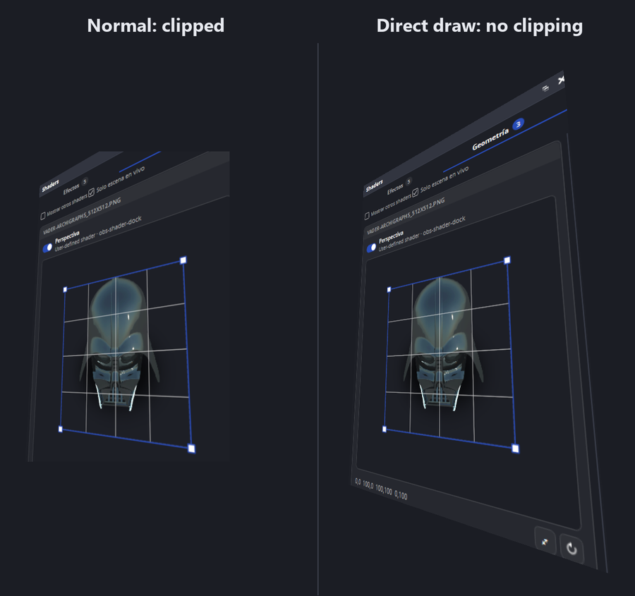

# 3D Effect 2

*A 3D rotation filter for OBS Studio, based on Exeldro's [3D Effect](https://github.com/exeldro/obs-3d-effect), that runs next to the original.*

Filtro para **OBS Studio** que gira y mueve una fuente en 3D. Parte del [3D Effect](https://github.com/exeldro/obs-3d-effect) de Exeldro (todo el crédito del filtro original es suyo) y agrega opciones para que la fuente no cambie de tamaño, no se corte al girar y se vea suave en ángulos fuertes. Tiene su propio id, así que **convive con el original**: puedes tener los dos instalados y tus escenas con 3D Effect siguen igual.

*[English below](#english)*

Mismos ajustes, con Conservar tamaño activo: a la izquierda el modo normal recorta lo que se sale del recuadro; a la derecha, Dibujar directo la muestra completa. / Same settings with Keep size on: normal mode clips what leaves the source bounds (left); Direct draw shows it whole (right).

## Descarga e instalación

Descarga el último [release](https://github.com/hjmeneses/obs-3d-effect/releases/latest) (compilado para OBS 33):

- **Windows:** con OBS cerrado, descomprime el `.zip` en `C:\ProgramData\obs-studio\plugins`.
- **Ubuntu:** `sudo apt install ./3d-effect-2-<versión>-x86_64-linux-gnu.deb`.
- **macOS:** instala el `.pkg`.

En una fuente: **Filtros → + → Efecto 3D 2** (en inglés, **3D Effect 2**).

## Qué agrega al 3D Effect

Todo está en el grupo **Opciones** del filtro y viene apagado, así que un filtro nuevo se comporta como el original hasta que lo cambies.

| Opción | Qué hace |
|---|---|
| Conservar tamaño y usar unidades reales | El campo de visión ya no cambia el tamaño de la fuente sin girar (como la perspectiva de CSS), y la posición X/Y/Z va en píxeles reales de la fuente, sin depender de la escala. |
| Margen | Espacio extra alrededor de la fuente, en % de su tamaño por lado, para que lo que gira hacia afuera no se corte. |
| Supersampling 2x | Dibuja al doble de resolución y reduce: orillas suaves y menos parpadeo en ángulos fuertes, a cambio de más GPU. |
| Ocultar la cara trasera | No dibuja la fuente cuando queda de espaldas a la cámara. |
| Dibujar directo (sin recorte) | Pinta la fuente con su perspectiva directamente en la escena, como BFX 3D Rotation: lo que gira hacia afuera se ve completo sin margen y sin textura intermedia. En este modo Margen y Supersampling no aplican. Debe ser el último filtro de la fuente, porque uno que venga después lo vuelve a recortar. |

Funciona con las transiciones de [Move](https://github.com/exeldro/obs-move-transition) igual que el original.

Para girarlo con el mouse arrastrando sobre la imagen de la fuente, usa [Shader Dock](https://github.com/hjmeneses/shader-dock).

## Compilar

Con la [plantilla oficial de plugins de OBS](https://github.com/obsproject/obs-plugintemplate): `cmake --preset windows-x64` y `cmake --build build_x64 --config RelWithDebInfo`. El código está en `src/`.

## Ramas

- `effect-2` (por defecto): 3D Effect 2.
- `improvements`: las primeras mejoras, todavía con el id del original (reemplazaba al 3D Effect en lugar de convivir con él). Ya no se actualiza.
- `master`: el original de Exeldro, sin cambios.

---

## English

A filter for **OBS Studio** that rotates and moves a source in 3D. It starts from Exeldro's [3D Effect](https://github.com/exeldro/obs-3d-effect) (all credit for the original filter is his) and adds options so the source keeps its size, does not get clipped when it rotates, and stays smooth at steep angles. It has its own id, so it **runs next to the original**: you can keep both installed and your 3D Effect scenes stay as they are.

**Download:** [latest release](https://github.com/hjmeneses/obs-3d-effect/releases/latest) (built for OBS 33). Windows: with OBS closed, extract the zip into `C:\ProgramData\obs-studio\plugins`. Ubuntu: `sudo apt install ./3d-effect-2-<version>-x86_64-linux-gnu.deb`. macOS: install the `.pkg`. Then add **Filters → + → 3D Effect 2**.

New options, in the filter's **Options** group and all off by default:

| Option | What it does |
|---|---|
| Keep size and use real units | The field of view no longer changes the size of the unrotated source (like CSS perspective), and Position X/Y/Z are real source pixels that do not depend on Scale. |
| Margin | Extra space around the source, as a percentage of its size on each side, so parts that rotate outward are not clipped. |
| Supersampling 2x | Renders at twice the resolution and scales down: smoother edges and less shimmering at steep angles, at the cost of more GPU. |
| Hide back face | Hides the source when it is turned away from the camera. |
| Draw directly (no clipping) | Paints the source with its perspective straight into the scene, like BFX 3D Rotation: whatever turns outward is fully visible with no margin and no intermediate texture. Margin and Supersampling do not apply. Keep it as the last filter on the source; a filter after it clips it again. |

It works with [Move](https://github.com/exeldro/obs-move-transition) transitions like the original. To rotate it by dragging over the source image, use [Shader Dock](https://github.com/hjmeneses/shader-dock).

Branches: `effect-2` (default) is 3D Effect 2; `improvements` holds the first changes, still under the original id (it replaced 3D Effect instead of running next to it) and is no longer updated; `master` is Exeldro's original, unchanged.

## License

GPL-2.0, like the original.
